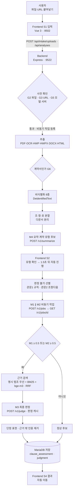
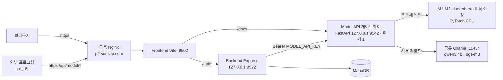

# 계약위험탐지서비스 (project2610)

계약서·약관을 올리면 **조항마다 위법·편법(우회) 위험을 찾고, 법령·공정위 사례·표준약관 근거와 함께 쉬운 말로 설명**하는 웹 서비스입니다.
법률 자문을 대신하지 않으며, 서명 전 「사전 위험 탐지 및 정보 제공」이 목적입니다.

> 기준 시점: **2026-10-01** (모델·API 부분은 이 날 실제 파일·코드·실행 중인 게이트웨이 `GET /v1/models` 로 다시 확인했습니다. 데이터 절은 2026-09-30 14:00 기준)
> 공개 주소: `https://p2.sumzip.com` (로그인 필요) · 외부 API: `https://p2.sumzip.com/api/model/<경로>` (발급 키 필요)

---

## 포트폴리오 요약

| 항목 | 저장소에서 확인할 내용 |
|---|---|
| 문제 | 약관·계약서의 위험 조항을 원문과 근거에 연결해 설명 |
| 구현 | 입력·비식별화·조항 분할 → KLUE RoBERTa 후보 탐지 → BM25·임베딩 근거 검색 → Qwen 기반 최종 설명 |
| 서비스 | TypeScript 백엔드와 웹 UI, Python 모델 서버, MariaDB, Ollama |
| 검증 | 학습/검증/시험 분리, 사건 단위 그룹 분할, 모델별 평가와 API 안정화 기록 |
| 한계 | 법률 자문이 아닌 사전 위험 탐지이며, 합성·약한 라벨의 제약은 아래 데이터·평가 절 참조 |

## 개인 담당 범위 (문상진)

| 항목 | 내용 |
|---|---|
| 개발 기간 | 2026.09.23~2026.09.30 |
| 실제 작업일 | 4일: 9/23·9/28·9/29·9/30 |
| 팀 규모 | 4명 |
| 진행 상태 | 개발 완료 |

문상진은 전체 구조 설계, 모델 선정·평가, API 설계와 작업 분배·리뷰를 담당했습니다.

- 서비스의 전체 구조와 구성 요소 간 흐름 설계
- 모델 선정·평가의 고려사항과 기준을 조정하고, 평가 결과를 검토해 개선 방향 결정
- LLM을 활용해 학습을 진행하고, 모의 입력 파일로 모델 응답을 평가·분석
- 파인튜닝 회차마다 LLM을 활용해 과적합과 데이터 누수 가능성 점검
- 백엔드와 모델 서버 사이의 API 설계
- 팀 작업 분배와 구현 결과 리뷰

아래의 모델 구현·데이터 구축·성능 수치는 **팀 전체의 결과**입니다. 문상진의 개인 기여는 위에 명시한 구조·API 설계, 모델 선정·평가와 작업 조율·리뷰 범위로 설명합니다.


### 설계 결정과 검토

| 결정 | 판단 근거와 적용 | 검증 범위 |
|---|---|---|
| Jev 대신 로컬 모델 | 프로젝트 환경에서 로컬 모델의 응답이 더 빠르다고 판단 | 동일 조건의 정량 비교 기록이 아닌 당시 관찰 |
| `klue/roberta-base` 선택 | 한국어 사전학습 모델로 위험 후보를 분류하고, 3차례 파인튜닝을 진행 | 회차별 데이터·평가 조건은 아래 학습·평가 기록 참조 |
| 양자화 Qwen3 4B + RAG | Ollama 모델에 DB의 법령·사례 근거를 제공해 최종 판정·설명 구성 | 근거 제공과 최종 판단 정확도를 구분해 평가 |
| BM25 적용 | RAG 조회 비용을 고려해 검색 성능 개선 시도 | 적용 전후의 지연 비교 수치는 없음 |
| 판단 모델 복수 배치 검토 | 판단층 처리량을 높이기 위한 구상 | 자원 부족으로 구현하지 않음 |

모의 입력 파일로 응답을 확인하고 결과를 분석해 개선 방향을 검토했습니다. 파인튜닝 회차마다 LLM을 활용해 과적합·데이터 누수 가능성을 점검했으며, 실제 검증 범위는 아래 데이터 분할·누수 감사·모델 평가 기록으로 설명합니다.

---

## 목차

1. [프로젝트 개요](#1-프로젝트-개요)
2. [데이터](#2-데이터)
3. [라벨 및 분류 기준](#3-라벨-및-분류-기준)
4. [모델 학습 데이터 (feature · target)](#4-모델-학습-데이터-feature--target)
5. [모델 구성](#5-모델-구성)
6. [모델 학습 방법](#6-모델-학습-방법)
7. [모델 평가](#7-모델-평가)
8. [서비스 전체 흐름](#8-서비스-전체-흐름)
9. [시스템 / API 구조](#9-시스템--api-구조)
10. [API 사용 예시](#10-api-사용-예시)
11. [실행 방법](#11-실행-방법)
12. [디렉터리 구조](#12-디렉터리-구조)
13. [API 안정화 / 테스트](#13-api-안정화--테스트)
14. [알려진 한계](#14-알려진-한계)
15. [향후 개선](#15-향후-개선)

---

## 1. 프로젝트 개요

### 해결하려는 문제

- 일반 이용자가 긴 약관 안에서 불리한 조항을 찾아내기 어렵습니다.
- 위험 조항은 대놓고 「책임지지 않는다」(**위법·직접형**)고 쓰기도 하지만, 겉으로는 권리를 인정하면서 비용·기간·절차·간주 같은 장치로 권리를 사실상 못 쓰게 만드는 경우(**편법·우회형**)가 많습니다. 이런 조항은 키워드 검색으로는 잡히지 않습니다.
- 조항을 「위험하다」고만 해서는 쓸모가 없습니다. **어떤 법령·어떤 공정위 사례와 비슷한지** 근거를 함께 보여 줘야 합니다.

### 목적과 원칙

단순 요약기가 아니라 다음 흐름 자체를 요구사항으로 둡니다.

**입력 → 비식별화 → 구조화(조항 분할) → 위험 탐지 → 근거 검색 → 위험 설명**

- 비식별화 전 텍스트는 DB·로그·모델 API 로 보내지 않습니다(코드에서 `DeidentifiedText` 타입만 허용).
- 「불공정 가능」「위법 가능」 판정에는 근거가 반드시 있어야 하고, 근거가 없으면 「분쟁 가능」으로 낮춥니다.
- 설명에서 단정하는 법률 표현(「무효이다」 등)은 걸러 냅니다(`shared/assertion-terms.json`).

### 주요 기능

| 기능 | 내용 |
|---|---|
| 입력 | PDF(텍스트·스캔 OCR), HWP, HWPX, DOCX, HTML, 공개 URL, 붙여넣기 · 최대 50MB/300쪽 |
| 개인정보 보호 | 주민번호·외국인번호·카드·계좌·전화·이메일·주소·이름 8종 마스킹(`〔라벨〕`), 원본 파일은 암호화 보관 후 보존기간 뒤 삭제 |
| 구조화 | 조·항·호 분할(조가 3개 미만이면 의미 단위), 한 파일에 여러 계약이 있으면 문서별로 분리 |
| 요약·계약 유형 | 문서 요약과 계약 유형 후보(전자상거래·구독·할부·방문판매·일반 소비자 거래·범위 밖) |
| 판정 불가 선별 | 모델 호출 전에 계약 조항이 아닌 입력·지시문 삽입(prompt injection)을 걸러 「판정 불가」로 표시 |
| 위험 탐지 | 조항마다 편법(M1)·위법(M2) 점수 → 위험 후보만 최종 판정(M3) |
| 근거 검색 | 법령 조문·공정위 결정·표준약관 하이브리드 검색(BM25 + bge-m3 임베딩, RRF) |
| 결과 | 4단계 판정(정상·분쟁 가능·불공정 가능·위법 가능), 위험 유형·수준·확신도, 근거 연결 설명, 원문 대조, 유사 사례 |
| 기록·피드백 | 분석 기록, 재분석(지식 갱신 후), 판정 피드백 |
| 운영 | 지식(법령·사례) 버전 관리, 품질 평가, 피드백 검토, 모델 서버 상태, API 키 관리 |
| 외부 API | 이용자가 발급한 키로 모델 API(요약·탐지·판정)를 직접 호출 |

---

## 2. 데이터

> **데이터와 서비스 모델의 관계**: 지금 서비스 중인 M1·M2 는 아래의 현재 데이터셋 **`model3_dataset_v2`** 로 학습한 3회차(Model 3) 모델입니다.
> 1회차(`baseline_v0`)·2회차(Model 2, `round2`·`round2r`)는 과거 이력이고 동결(FROZEN)했습니다.

> **이 저장소에 들어 있지 않은 것**: 데이터 원천·데이터셋(`data_source/`·`dataset_work/`·`tools/workspace/`)과 학습된 모델 가중치(`model-server/var/models/`)는 외부 배포가 제한된 원문이 섞여 있고 용량이 커서 공개 저장소에 올리지 않았습니다.
> 아래 표·절의 해당 경로는 원래 작업 환경 기준의 기록입니다. 데이터를 만들고 학습한 **코드**는 모두 들어 있습니다 — `tools/`(데이터셋 빌드·검수·증강, `tools/evasion_v4/`), `model-server/training/`(학습·평가·내보내기).
> 가중치 없이도 모델 API 스텁(`tools/model-api-stub`)으로 서비스 전체 흐름을 띄울 수 있습니다(§11).

| 구분 | 위치 | 상태 |
|---|---|---|
| 학습 데이터셋 (현재) | `data_source/model_3/datasets/model3_dataset_v2/` · 포인터 `data_source/model_3/datasets/CURRENT.json` | CURRENT |
| 평가셋 (공식) | `data_source/model_3/datasets/model3_eval_gen2/` (평가 2세대) | CURRENT |
| 원천 색인 | `data_source/model_3/registry/master_real_registry_v2/` | CURRENT |
| 과거 | `model3_dataset_v1`, 평가 1세대 `v1_6_candidate`, `data_source/model_2/`(Model 2 = `model_dataset_v1_5_qc`), `dataset_work/master/baseline_v0/` | HISTORICAL / FROZEN |

`model3_dataset_v1` 과 `v2` 의 차이는 편법 TRAIN 합성 10행의 `contract_type`·`title` 보정 하나뿐입니다(`model3_dataset_v2/EXPORT_MANIFEST.json`).

### 2-1. 데이터 출처

| 출처 | 규모 | 쓰임 |
|---|---|---|
| **공정위 불공정약관 시정 사례** (보도자료·첨부, v1) | 사건 82 · 조항 1,000 → official **934**(전자상거래 455 · 비전자상거래 479) + 시정 후 조항 | 위법·편법 real 학습·평가의 중심 |
| **실제 약관** (국내 전자상거래 플랫폼 크롤링, v1) | 유효 99문서(47곳) · 조항 2,752 | 평가 Negative, 판정 불가 관문 보정 |
| **법제처 OPEN API** (v2 → 정제 `v2_prep`) | 법령 13건·조문 3,358 · 행정규칙(표준약관) 16건 · 공정위 결정문 1,096건 | 서비스 근거 지식(RAG), 평가 real |
| **외부 공정위 보도자료** (ftc.go.kr 「약관」 게시물) | 478건 중 218건 수집 → 위법 seed 514 | 위법 합성의 부모 seed |
| **case.ftc.go.kr 의결서** | registry 435행 | 편법 seed·평가 |
| **판례 · 공공 누리집 약관 · 공정위 표준약관** | 209 · 34 · 120행 | 평가 전용 |

Master registry v2 기준 real 조항은 모두 **5,972행**입니다(`registry/master_real_registry_v2/SUMMARY.json`).
v1 실제 약관 중 스크래핑 제한을 고지한 문서(policy_hold)는 유효셋에서 뺐고, 원문은 외부에 배포하지 않습니다.

### 2-2. REAL / Synthetic 구분

**합성 데이터는 TRAIN 에만 있습니다. VALIDATION·TEST 는 100% real 입니다.**

| 모델 · 분할 | 행 | real | synthetic |
|---|--:|---|---|
| 위법 TRAIN FULL | 2,885 | 922 (P 538 / N 384) | 1,963 (P 1,692 / N 271) |
| 위법 TRAIN STRICT | 2,623 | 718 (P 538 / N 180) | 1,905 (P 1,634 / N 271) |
| 편법 TRAIN | 783 | 532 (P 108 / N 424) | 251 (P 만) |
| 모든 VALIDATION · TEST | — | 100% | 0 |

- 위법 real: P 538 = 공정위 official 문제 조항, N 384 = 같은 사건의 **시정 후 조항**.
- 편법 real: 모두 공정위 official 조항. P 108 = 회피 구조가 있는 조항, N 424 = 위험하지만 회피 구조는 없는(직접형) 조항.
- 편법 TRAIN Positive 의 약 70% 가 합성입니다.

### 2-3. 수집 · 전처리

| 단계 | 내용 | 근거 |
|---|---|---|
| API 키 제거 | 법제처 원본 링크 약 1.9만 곳에 박힌 OC 키를 제거, 키는 환경변수로만 | `data_source/v2_prep/REPORT.md` |
| 개인정보 재마스킹 | 원본(raw)에서 다시 `[주소]`·`[이름]`·`[주민번호]` 로 치환(기존 방식이 기간·금액을 훼손해서 다시 함). 기간·금액 표현 8,782개가 원본과 같은지 검증 | 같은 파일 |
| 본문 정리 | 이미지·각주 표지 치환, 붙은 목록 번호 분리, 조가지번호 복원, 사건번호 정규화·사건그룹ID, 2,000자 초과 청크 분할 | 같은 파일 |
| 모델 입력 정리 (`text_clean_v1`) | (삭제)·(신설) 등 편집 표시와 문서명 머리말 제거 — **시정 후 문구에만 붙는 편집 표시가 Negative 단서가 되지 않게**. 회사·서비스명을 「회사」로, URL 제거 | `tools/workspace/text_clean_v1.py` |
| 제외 | 법적위험 불확실, 평가 분할의 약한 라벨, 512토큰 초과, 정리 후 본문 없음, 완전중복 등 | `data_source/model_2/workspace/06_model_dataset/EXPORT_MANIFEST.json` |

### 2-4. 증강 방법

- **LLM 패러프레이즈 변형**입니다. 템플릿·규칙 치환이 아닙니다. 공정위 real 조항 1개를 seed 로 삼아 어순, 조건·단서 위치, 능동↔피동, 문장 분리·병합 같은 **변형 축**(`variation_axes`)을 바꿔 새 문장을 씁니다.
  - 편법: seed 당 5~11개를 생성했는데 쓸 만한 것은 2~3개가 한계였습니다.
  - 위법: seed 당 1~3개.
- 생성·QC 에는 Claude Opus 5.5 서브에이전트를 썼습니다(`08_synthetic_augmentation/production_pilot_v1/report.md`, 편법 행의 `generator` 필드). 위법 신규 623행과 편법 v4 10행은 생성 모델이 행에 기록되지 않아 **확인되지 않음**입니다.
- 합성 Negative 271 은 두 판정이 모두 CLEAR 인 real Negative 180 에서만 파생했습니다.
- 합성 내역: 위법 P = 기존 통합 1,069 + 신규 seed 라운드 623 / 편법 P = 최종 pool 225 + 신규 라운드 16 + v4 10.

### 2-5. QC 방법

**QC1(독립 LLM) → QC2(QC1 결과를 가린 블라인드) → 재판정 표본 → 기계 gate → `FINAL_ACCEPT`** 순서입니다. 최종 판정은 LLM 판정과 기계 검사 중 **더 나쁜 쪽**을 따릅니다.

- **기계 gate**
  - 중복: 완전중복·근접중복(문자 3-gram Jaccard ≥ 0.9). 비교 대상은 원문, 형제 후보, 다른 seed, TRAIN real
  - 평가셋과 가까운지: J ≥ 0.9 또는 4-gram 포함률 ≥ 0.8
  - 원문과 너무 같은지: 원문 J ≥ 0.75, 형제 J ≥ 0.70, 문장 골격 유사도 ≥ 0.75
  - 새로 들어간 숫자·법령·기관 어휘, 길이 비율, LLM 투 어절, 문체 gate
- **수율 예시(편법)**: 후보 772 → QC1 통과 589 → QC2 통과 238 → FINAL 225
- **seed 근거 등급(외부 공정위)**: A = 판단 이유와 법조를 원문에서 모두 확인, B = 판단 이유만 확인, C = 불완전(보류). 신규 위법 623의 부모는 A 292 · B 303 · 기존 확정 28입니다.
- **사람 검수는 아직 없습니다.** `FINAL_ACCEPT` 는 LLM QC 2회와 기계 gate 를 통과했다는 뜻이지 사람 승인이 아닙니다.

### 2-6. TRAIN / VALIDATION / TEST (현재 `model3_dataset_v2`)

| 모델 | 분할 | 행 | P | N |
|---|---|--:|--:|--:|
| 위법 | TRAIN FULL | 2,885 | 2,230 | 655 |
| 위법 | TRAIN STRICT | 2,623 | 2,172 | 451 |
| 위법 | VALIDATION | 154 | 66 | 88 |
| 위법 | TEST | 176 | 87 | 89 |
| 편법 | TRAIN | 783 | 359 | 424 |
| 편법 | VALIDATION | 99 | 12 | 87 |
| 편법 | TEST | 128 | 26 | 102 |

- **FULL vs STRICT(위법 TRAIN)**
  - FULL = 기존 라벨 정책 그대로입니다.
  - STRICT = 합성 가운데 세 판정이 모두 ACCEPT 인 핵심 1,011 만 남기고(secondary 58 제외), real Negative 는 두 판정이 모두 CLEAR 인 180 만 씁니다(의심·불일치 204 제외).
  - 둘 다 학습 후보이고, 고르는 일은 모델 단계에서 합니다.
- 위법 FULL·STRICT 의 VAL/TEST 는 같은 파일이며, 모든 VAL/TEST 는 `model3_eval_gen2` 와 바이트 단위로 같습니다(sha256 동일).
- 평가 2세대에는 1세대 행이 모두 들어 있습니다. 신규 행은 위법 VAL 47 · TEST 47, 편법 VAL 32 · TEST 34 입니다.

### 2-7. 데이터 누수 방지 원칙

1. **사건 단위 그룹 분할**: 완전중복·근접중복(3-gram J ≥ 0.9)을 `분할그룹ID`(`CASE:<사건ID>`)로 묶고, 그룹 해시(sha256 % 100)로 TEST 10 · VAL 10 · 나머지 TRAIN 에 배정합니다(`data_source/v2_prep/scripts/build_master.py`).
2. **평가는 real 만, 평가셋은 평가에만**: VAL/TEST 를 TRAIN 에 합치거나 증강 seed·합성 부모·재학습 원천으로 쓰지 않습니다. TEST 는 모델·임계값 선택에 쓰지 않습니다(`data_source/model_3/README.md` §5).
3. **합성의 부모는 TRAIN real 만**: 합성을 부모로 쓴 행은 0 입니다. 합성 자식은 부모의 `분할그룹ID` 를 물려받습니다.
4. **모델을 건너는 누수도 막음**: gate 의 TRAIN 범위는 두 모델의 TRAIN, 합성 pool, seed registry 전체입니다.
5. **Holdout**: 기준을 만들 때 보지 않은 96행(10사건)은 ID 만 남기고 열람·seed 사용을 금지했습니다.
6. **최종 검증**: TRAIN↔평가에서 ID·본문·정규화 본문·사건 그룹·문서·family 겹침 0, VAL↔TEST 0, Holdout 0, 평가 gate 13/13 PASS. 평가 행을 일부러 TRAIN 에 넣어 gate 가 실제로 잡는지도 확인했습니다.

남은 문제(막지는 않음): 4-gram 포함률 ≥ 0.8 인 근접 쌍이 위법 4 · 편법 6 쌍 있고, TRAIN Negative 1행이 VAL Positive 1행의 문장을 거의 그대로 포함합니다(`SUMMARY.json` `known_conflict_42204_43638`).

### 2-8. Provenance / Lineage 기록 위치

| 무엇 | 파일 (`data_source/model_3/` 기준) |
|---|---|
| 위법 TRAIN 행별 출처 | `datasets/model3_dataset_v2/train_row_sources.jsonl` |
| 편법 합성 계보 (251/251) | `datasets/evasion_train_candidate_v4_p1/final_synthetic/evasion_synthetic_lineage_v4_p1.jsonl` |
| 편법 10행 보정 기록 | `datasets/model3_dataset_v2/evasion_metadata_fix_v2.jsonl` |
| 평가 행별 출처 | `datasets/model3_eval_gen2/eval_lineage_gen2.jsonl` |
| 중앙 색인 | `registry/master_real_registry_v2/` (master registry, 합성 계보 색인, 소유권, ID 대조, 충돌, 누수 감사) |
| 경로·계보 색인 | `MODEL3_LINEAGE.json`, `MODEL3_PATHS.json`, `tools/workspace/model3_paths.py` |
| 원천 패키지 | `data_source/v1/TRANSFER_MANIFEST.json` (원래 경로 + SHA-256) |

각 행에도 `origin`(real/synthetic), `데이터출처`, `분할그룹ID`, 합성이면 `meta.source_data_id`·`case_id`·`evidence_grade` 가 들어 있습니다.

---

## 3. 라벨 및 분류 기준

### 3-1. 위법과 편법

두 모델은 **서로 독립된 이진 분류기**입니다. 같은 조항이 두 모델에서 다른 라벨을 가질 수 있습니다.

| | 위법 모델 (`direct_legal_detector`, M2) | 편법 모델 (`evasion_detector`, M1) |
|---|---|---|
| Positive (1) | 조항 문언 자체에 약관법상 위법(불공정) 위험이 있음 | 겉으로는 적법해 보이게 쓰였지만 실질적으로 소비자 권리를 우회·제한함 |
| Negative (0) | 위법 위험 없음 | 편법·우회 위험 없음 (직접형 위험 조항 포함) |

**편법(회피 구조)의 정의** (`data_source/model_2/workspace/02_labeling_rules/evasion_pattern/README.md`):
> 표면적으로 이용자의 권리를 인정하면서(S), 비용·기간·승인·절차·예외·간주 같은 장치(M)로 그 권리의 실제 효과를 약하게 만드는(E) 구조.
> 직접 금지·직접 면책은 위험할 수는 있어도 회피 패턴이 아니다.

판정 순서는 S → M → L → E 입니다.

### 3-2. DIRECT / EVASION / MIXED / UNCERTAIN

`meta.structure_type` 에 들어 있는 **구조 유형 메타데이터이며, 학습 클래스가 아닙니다.**

| 값 | 의미 |
|---|---|
| DIRECT | 직접 금지·면책·권한 등. 하위 유형은 D_EXEMPT, D_PROHIBIT, D_POWER, D_WAIVER, D_SHIFT, D_LICENSE, D_OTHER |
| EVASION | 위 S-M-E 회피 구조 |
| MIXED | 직접형과 회피형이 한 조항에 섞임 |
| UNCERTAIN | 구조를 확정하지 못함 |

위법 모델은 구조 유형과 관계없이 법적 위험 라벨을 따릅니다. EVASION·MIXED 행이라도 법적 위험이 있으면 1 입니다.

실제 구성은 이렇습니다.
- 위법 TRAIN real P 538: DIRECT 356 · EVASION 95 · MIXED 3 · UNCERTAIN 84
- 편법 TRAIN real P 108: EVASION 104 · MIXED 4
- 편법 TRAIN real N 424: 전부 DIRECT

### 3-3. 편법 패턴 코드 (working criteria v1.1)

`data_source/model_2/workspace/02_labeling_rules/evasion_pattern/evasion_working_criteria_v1_1.json`
채택 코드는 **17개(EP 11 + GN 6)** 입니다. class A/B 는 패턴의 확실성 등급입니다.

| 코드 | 이름 | class |
|---|---|:-:|
| EP01 | 권리행사·보호 기간의 단축·기산점 조작·정지 부재 | B |
| EP02 | 최소 이행·수령 사실로 권리 전부 소멸 | A |
| EP03 | 권리행사의 비용화(공제·위약금·혜택 환원·절벽형 환급) | B |
| EP04 | 대가·보증금·환급 지급의 수단 치환·지연·조건부 보류 | B |
| EP05 | 원칙·보장 선언 후 광범위·불명확 예외 | A |
| EP06 | 권리행사 절차·경로 장벽 | B |
| EP08 | 부작위·행위에 의한 동의·승인·갱신·포기 의제 | B |
| EP10 | 권리·보장 내용을 사업자 재량·하위정책·일방 대체에 유보 | A |
| EP12 | 이용자 의무 이행을 조건으로 한 책임·보장 발생·유지 제한 | B |
| EP13 | 권리행사·종료에 결부된 부수 손실 | B |
| EP14 | 형식적 해지권(해지 효과 이연·환급 없음) | A |
| GN01 | 종료·삭제 효과의 무력화 | B |
| GN02 | 권리행사·선택에 다른 권리 포기 결부 | A |
| GN03 | 제3자 거래 허용 후 사업자 조건 구속 | B |
| GN04 | 선택 동의권의 묶음·필수화 | B |
| GN05 | 권리 성립 요건·대상 범위의 과소·모호 한정 | B |
| GN06 | 권리 귀속 인정 후 행사 주체 이전 | A |

- EP07·EP09·EP11 은 회피 코드에서 빼고 보조 위험 표지(RF_VENUE, RF_NOTICE, RF_LIABILITY_LIMIT)로 옮겼습니다.
- EP 는 전자상거래 official 455행(35사건)에서, GN 은 비전자상거래 383행(31사건)에서 뽑았습니다. GN 은 Holdout 검증 전입니다.
- 편법 TRAIN real P 108의 코드 분포(한 행에 여러 코드 가능)
  - EP: EP08 22, EP10 20, EP05 15, EP03 11, EP06 10, EP04 9, EP02 8, EP13 4, EP14 2
  - GN: GN01 6, GN02 4, GN04 2, GN05 2, GN03 1, GN06 1
  - EP01·EP12 는 TRAIN real 에 없습니다.

### 3-4. 위험 유형 · 판정 등급 (서비스 출력)

| 항목 | 값 | 누가 정하나 |
|---|---|---|
| 판정(risk_class) | `normal` 정상 · `dispute` 분쟁 가능 · `unfair` 불공정 가능 · `illegal` 위법 가능 | M3 (근거 없으면 unfair·illegal 금지) |
| 위험 유형(risk_type) | `rights_limit` 권리 제한 · `liability_avoid` 책임 회피 · `refund_cancel_limit` 환불·해지 제한 · `unilateral_change` 일방적 변경 · `excessive_penalty` 과도한 위약금 · `vague` 모호 · `other` | M3 |
| 위험 수준 / 확신도 | high·mid·low / high·medium·low | M3 |

데이터셋의 `meta.legal_risk_types`(한글: 책임면제·환불제한·일방적계약변경 등)는 규칙 매핑(HEURISTIC) 메타데이터이며 **학습 타깃이 아닙니다.**

---

## 4. 모델 학습 데이터 (feature · target)

학습 파일(JSONL)의 공통 컬럼은 다음과 같습니다.
`{데이터ID, text, contract_type, title, label, label_level, weak_label, reviewed, origin, 데이터출처, 분할그룹ID, 데이터분할, meta}`

| 모델 | feature (실제 입력) | target |
|---|---|---|
| M1 편법 (서비스 중: ordneg 미세조정) | `"{계약유형 한글} [SEP] {조 제목} [SEP] {조항 본문}"` 최대 512토큰 | `label` (1 = 편법) |
| M2 위법 (서비스 중: ordneg 미세조정) | M1 과 같은 형식, 최대 512토큰 | `label` (1 = 위법) |

- **평범한 조항 음성(ordneg)**: 공식 `model3_dataset_v2` 에 실제 약관의 평범한 조항(사람 검수 없는 약한 라벨 0)을 학습 478행 더했습니다. 선택용 ordVAL 202 · 확인용 ordTEST 168 은 따로 둡니다. 공식 평가(gen2)에 쓰인 운영사 25곳은 모두 빼고 운영사 단위로 나눴습니다(`dataset_work/model3_ordneg_v1/`, `tools/model3/build_ordneg_v1.py`).

- **결측 처리**: `title` 이 없으면 빈 문자열(`title or ''`)이고, 대체값을 따로 만들지 않습니다.
  - 위법 FULL TRAIN 에서 `title` 이 없는 행은 2,109 입니다.
  - `contract_type` 이 없는 행은 위법 FULL TRAIN 595(모두 신규 합성 P), 편법 TRAIN 16 입니다.
- **계약 유형 표기**: 서비스는 영문 코드를 한글로 바꿉니다(`ecommerce`→전자상거래, `subscription`→구독, `installment`→할부, `door_to_door`→방문판매, `general_consumer`→일반 소비자 거래, `out_of_scope`→범위 밖; `model-server/app/classifiers.py`). 학습 데이터의 값(기타·중개·금융·플랫폼·구독·쇼핑)은 이 표에 없어 그대로 들어갑니다.
- **메타데이터는 입력에 넣지 않습니다**: `label_level`, `origin`, `데이터출처`, `meta` 는 분석·층화 평가용입니다.
- **형식 단서 주의**: 위법 평가에서 제목·길이·출처 같은 형식 정보만으로도 AUC 0.7~0.9 가 나옵니다. 그래서 평가 때 길이를 통제한 AUC 를 같이 봅니다(§7).

---

## 5. 모델 구성

서비스에 쓰는 모델은 **4개(M1~M4) + 임베딩 1개**입니다. M3·M4 는 학습하지 않은 공용 LLM 하나를 역할만 나눠 씁니다.
확인 방법: `GET /v1/models`, `model-server/.env` 의 `MODEL_ROOT` = `model-server/var/models/model3/serving_ordneg` (2026-09-30 17:22 반영, 2026-10-01 실행 중 게이트웨이에서 확인).

| 모델 | 역할 | base / checkpoint | 입력 | 출력 | target | 주요 기능 |
|---|---|---|---|---|---|---|
| **M1** 편법·우회 탐지 | 조항 1차 선별(편법) | `evasion-ordneg-klue-roberta@m3_ordneg_v1-2026-09-30` — klue/roberta-base 전체 미세조정 2클래스(3 에폭), PyTorch CPU (`serving.kind: seqcls`) | 계약유형·제목·본문 | `{label: loophole\|none, type: null, score}` | 편법 1/0 | VAL 임계값 0.0929 를 0.5 로 다시 맞춘 점수 → 백엔드 임계 0.5 |
| **M2** 위법 탐지 | 조항 1차 선별(위법) | `illegal-ordneg-klue-roberta@m3_ordneg_v1-2026-09-30` — klue/roberta-base 미세조정(CONCAT, seed 43, 2 에폭), PyTorch CPU (`serving.kind: seqcls_binary`) | 계약유형·제목·본문 | `{label: illegal\|none, type: null, related_laws: [], score}` | 위법 1/0 | VAL 임계값 0.0155 를 0.5 로 맞춘 점수. 법률 헤드는 없음 |
| **M3** 최종 판정 | 위험 후보 조항의 최종 판정·설명 | 공유 Ollama `qwen3:4b-instruct-2507-q4_K_M` (학습 없음) | 조항 + M1·M2 점수 + 검색 근거(≤10) + 관점 + 지식 기준일 | `risk_class`·`risk_type`·`risk_level`·`confidence`·`explanation[{claim, evidence_ids}]` (JSON 스키마 `schemas/judge.json`) | — | 근거 ID 밖의 인용과 단정 표현 제거 |
| **M4** 요약 | 문서 요약 · 계약 유형 후보 | M3 와 같은 모델 | 조항 목록 | `summary`, `contract_type_candidates`(≤3) (`schemas/summarize.json`) | — | 계약 유형 자동 제안 |
| 임베딩 | 근거 검색·판정 불가 관문·M1 입력 | 공유 Ollama `bge-m3` (1024차원) | 텍스트 ≤ 8,000자, 한 번에 32개 | 벡터 | — | 하이브리드 RAG |

- M3·M4 생성 설정: temperature 0, top_k 1, seed 0, think false, `num_ctx 8192`, `keep_alive 5m`, 게이트웨이 전체 동시 1건. 같은 입력이면 같은 판정이 나오고, 판정 캐시가 있습니다.
- 과거 서비스 모델(이력):
  - 2026-09-30 14:02 ~ 17:22: 3회차 `serving_r3`(M1 = bge-m3 + RBF SVM, M2 = 미세조정 + TF-IDF 앙상블), 이어서 잠시 `serving_mix`
  - 2026-09-29 ~ 09-30 14:02: 1회차 `baseline_v0`
  - M1 = klue/roberta-base 8클래스(none + 위험 유형 7)
  - M2 = 이진 + 법률 5종 다중 라벨 헤드

---

## 6. 모델 학습 방법

학습 코드는 `model-server/training/` 에 있습니다. 실행 기록과 보고서는 다음과 같습니다.
- 3회차: `model-server/var/models/model3/m3_round3_v1/`, `data_source/model_3/runs/m3_round3_v1/ROUND3_REPORT.md`
- 평범한 조항 음성(서비스 중): `model-server/var/models/model3/m3_ordneg_v1/`, `data_source/model_3/runs/m3_ordneg_v1/ORDNEG_REPORT.md`

6-2 의 미세조정 설정은 ordneg 에도 그대로 씁니다(데이터만 평범한 조항 478행 추가).

### 6-1. 규칙 (3회차)

- 학습은 TRAIN 만 씁니다.
- 에폭·하이퍼파라미터·임계값·방법 선택은 **VALIDATION 만** 씁니다.
- TEST 는 확정 후 한 번만 추론합니다(`RUN_MANIFEST.json`: `validation_in_final_training: false`, `test_inference_count: 1`).

### 6-2. 미세조정 (`training/train_r3_finetune.py`)

| 항목 | 값 |
|---|---|
| pretrained | `klue/roberta-base` (로컬 `model-server/var/hf/klue-roberta-base`) |
| 방식 | 전체 미세조정(full fine-tuning), 2클래스 `AutoModelForSequenceClassification` |
| 하이퍼파라미터 | 최대 5 에폭, lr 2e-5, batch 16, max_len 512, weight decay 0.01, warmup 6%, grad clip 1.0, seed 42 (+43·44 반복) |
| loss / optimizer | Cross-Entropy / AdamW, linear 스케줄. `--class-weight` 변형은 역빈도 가중 n/(2·count) |
| 에폭 선택 | VAL AUC 최고(동점은 0.5 기준 F1) |
| 임계값 | VAL F1 최대(0.05~0.95, 0.01 간격) |
| 저장 | `save_pretrained`(safetensors) + tokenizer |

학습 데이터 변형은 FULL, STRICT, CONCAT(FULL + STRICT 를 이어 붙인 5,508행 — STRICT 행이 두 배 가중), 각각 class-weight 유무를 비교했습니다.

### 6-3. 고전 방법 (`training/r3_classical.py`, `r3_embed.py`)

VAL AUC 로 하이퍼파라미터를 골랐습니다.
- 형식 단서만 쓰는 점검 모델(길이·제목 유무·계약 유형). 후보가 아니라 비교 기준입니다.
- 글자 2~4-gram TF-IDF + 로지스틱 회귀
- bge-m3 임베딩 + LR / PCA+LR / KMeans 거리 + LR / kNN / RBF SVM
- 앙상블

### 6-4. 서비스 모델 선택과 내보내기

| 모델 | 선택 | 근거 | 내보내기 |
|---|---|---|---|
| M1 (서비스 중) | ordneg 편법 미세조정, 임계 0.0929 | 선택 규칙 = ordVAL 오탐 ≤ 5% 안에서 공식 VAL 재현율 최대. 규칙상 1순위는 앙상블(SVM w=0.1)이었지만 VAL 양성 12개 중 3개 차이라, ordVAL 오탐(0.5% vs 2.5%)과 M3 호출 비율이 낮은 미세조정을 골랐습니다(사용자 승인 2026-09-30) | `encoder` safetensors + tokenizer (`serving_ordneg/loophole-klue-roberta-base/`) |
| M2 (서비스 중) | ordneg 위법 미세조정(CONCAT s43), 임계 0.0155 | 같은 규칙에서 1순위. VAL AUC 0.932 · 재현율 0.939 | `serving_ordneg/illegal-klue-roberta-base/` |
| M1 (3회차, 이력) | bge-m3 + RBF SVM (C=10), VAL 에 Platt 적합, 임계 0.2652 | 3회차 미세조정(TEST AUC 0.820)보다 우세 | `training/r3_export_svm.py` → `svm.npz` |
| M2 (3회차, 이력) | CONCAT 미세조정(seed 43) + TF-IDF LR 앙상블 | 3시드 앙상블 중 VAL AUC 최고(0.9186) | `training/r3_export_legal.py` → `encoder/` + `tfidf.npz` |

- 평범한 조항에서 M3 를 부르는 비율(둘 중 하나라도 위험, ordVAL / ordTEST): 3회차 9.4% / 11.9% → ordneg 3.5% / 6.0%.

- 로딩: `model-server/app/classifiers.py` 가 `model_card.json` 의 `serving.kind` 를 보고 해당 클래스를 올립니다. 서비스 중인 ordneg 는 `seqcls`(M1, `TorchLoophole`) · `seqcls_binary`(M2, `TorchBinaryIllegal`), 3회차는 `embed_svm` / `ensemble_binary` 입니다.
  - 게이트웨이 기동 시 한 번, 백그라운드 스레드에서 적재합니다. 적재 중에는 `/health` 가 503 `loading` 입니다.
- 되돌리기(3회차와 섞어 쓰기): `model-server/.env.bak-20260930-mix` → `.env` 후 `launchctl kickstart -k user/$(id -u)/kr.crd.model-server`.

### 6-5. 이전 회차 (이력)

| 회차 | 데이터 | 방식 | 상태 |
|---|---|---|---|
| 1회차 `baseline_v0` | `dataset_work/master/baseline_v0/split/` 2,249 / 253 / 363 (모두 real) | `training/train.py`. M1 8클래스 CE, M2 이진+법률 5종 BCE. 4 에폭, dev F1 최고 에폭 저장, 임계 0.5 | 2026-09-30 14:02 까지 서비스, 지금은 보관 |
| 2회차 `round2`·`round2r` | `model_dataset_v1_2_qc` / `v1_5_qc` | `training/train_binary_cv.py`. TRAIN+VAL 풀 그룹 5-fold CV 로 에폭 선택 후 전체 재학습 | FROZEN — VAL 이 학습에 들어가 held-out 이 아님 |

---

## 7. 모델 평가

**평가 지표**: Precision · Recall · F1(부트스트랩 95% CI) · ROC-AUC · 오탐률(FPR) · 혼동행렬 · 길이 통제 AUC(같은 길이 5분위 안에서만 비교).
Accuracy 는 1회차 model card 에만 있습니다. **PR-AUC 는 미측정**입니다.

### 7-1. 서비스 중인 M1·M2 — ordneg (평가셋 `model3_eval_gen2`, real 만)

출처: `model-server/var/models/model3/serving_ordneg/*/model_card.json`, `data_source/model_3/runs/m3_ordneg_v1/compare.json`. 혼동행렬은 TEST 의 n·P·재현율·정밀도에서 계산했고, F1 이 모델 카드 값과 일치합니다. 게이트웨이(CPU)로 다시 채점한 결과도 오프라인과 같습니다.

| 모델 | 분할 | n (P) | AUC | F1 | Precision | Recall | FPR | TP / FP / FN / TN | 평범한 조항 오탐 ordVAL / ordTEST |
|---|---|---|--:|--:|--:|--:|--:|---|--:|
| M2 위법 | VAL | 154 (66) | 0.9322 | — | — | 0.9394 | — | — | 3.0% / 3.6% |
| M2 위법 | **TEST** | 176 (87) | **0.9513** | **0.8466** | 0.7843 | 0.9195 | 24.7% | 80 / 22 / 7 / 67 | |
| M1 편법 | VAL | 99 (12) | 0.8879 | — | — | 0.6667 | — | — | 0.5% / 3.0% |
| M1 편법 | **TEST** | 128 (26) | **0.8767** | **0.7059** | 0.7200 | 0.6923 | 6.9% | 18 / 7 / 8 / 95 | |

```
M2 위법            예측 위법   예측 정상        M1 편법            예측 편법   예측 정상
정답 위법 (87)         80          7         정답 편법 (26)         18          8
정답 정상 (89)         22         67         정답 정상 (102)         7         95
```

- M2 는 3회차 앙상블보다 재현율이 높고(0.874 → 0.920) 정밀도는 낮습니다(0.894 → 0.784). 대신 평범한 조항 오탐이 6.4% / 10.7% → 3.0% / 3.6% 로 줄었습니다.
- 평범한 조항 라벨은 사람 검수 없는 약한 라벨이고, 편법 평가 양성이 적습니다(VAL 12 · TEST 26).

#### 3회차 `serving_r3` (2026-09-30 14:02 ~ 17:22 서비스, 이력)

출처: `model-server/var/models/model3/serving_r3/*/model_card.json`

| 모델 | 분할 | n (P) | AUC | F1 | Precision | Recall | FPR | TP / FP / FN / TN |
|---|---|---|--:|--:|--:|--:|--:|---|
| M2 위법 (앙상블 s43) | VAL | 154 (66) | 0.9186 | 0.8507 | 0.8382 | 0.8636 | 12.5% | 57 / 11 / 9 / 77 |
| M2 위법 (앙상블 s43) | **TEST** | 176 (87) | **0.9263** | **0.8478** | 0.8041 | 0.8966 | 21.4% | 78 / 19 / 9 / 70 |
| M1 편법 (bge-m3+SVM) | VAL | 99 (12) | 0.9013 | 0.7333 | 0.6111 | 0.9167 | 8.1% | 11 / 7 / 1 / 80 |
| M1 편법 (bge-m3+SVM) | **TEST** | 128 (26) | **0.8661** | **0.6000** | 0.6250 | 0.5769 | 8.8% | 15 / 9 / 11 / 93 |

혼동행렬(TEST, 행 = 정답 · 열 = 예측):

```
M2 위법            예측 위법   예측 정상        M1 편법            예측 편법   예측 정상
정답 위법 (87)         78          9         정답 편법 (26)         15         11
정답 정상 (89)         19         70         정답 정상 (102)         9         93
```

- M1 TEST F1 95% CI 는 [0.42, 0.75]로 넓습니다. 편법 평가 Positive 가 VAL 12 · TEST 26 뿐이기 때문입니다(`ROUND3_REPORT.md`).
- 형식 단서 점검: 위법 형식 전용 모델의 TEST AUC 는 0.850 입니다.
  - 길이를 통제한 AUC: 위법(FULL 미세조정 기준) 0.898, 편법 0.891
  - 형식 전용 모델의 길이 통제 AUC: 위법 0.673, 편법 0.336
  - 형식 단서를 빼도 판별력이 유지됩니다.
- 같은 94행에서 2회차와 비교: 위법 AUC 0.908 → 0.930, 편법 AUC 0.873 → 0.924 (`r2_vs_r3_same_rows.json`).
- 긴 조항 약점: 채택 위법 단일 모델의 TEST F1 은 100자 미만 0.93 · 100~250자 0.76 · **250자 이상 0.44** 입니다.

### 7-2. 이전 회차 (참고, 평가셋이 달라 직접 비교 불가)

| 회차 | 모델 | 평가셋 | P | R | F1 | AUC |
|---|---|---|--:|--:|--:|--:|
| baseline_v0 | M1 (점수 ≥ 0.5) | eval 363 (P 72) | 0.783 | 0.750 | 0.766 | 0.938 |
| baseline_v0 | M2 | eval 363 (P 36) | 0.619 | 0.722 | 0.667 | 0.947 |
| round2r | M2 | TEST 94 (P 70) | 0.951 | 0.829 | 0.886 | 0.908 |
| round2r | M1 | TEST 94 (P 22) | 0.824 | 0.636 | 0.718 | 0.876 |

출처: `dataset_work/reports/baseline_v0/ROUND1_REPORT.md`, `model-server/var/models/round2r/*/model_card.json`

### 7-3. M3 · M4 · 전체 흐름

| 항목 | 결과 | 출처 |
|---|---|---|
| M3 처리량 (50회) | 호출당 중앙값 2.74초. 30건 기준 클라이언트 동시 1/2/4/6 = 82.0 / 83.9 / 86.3 / 80.8초 (기준 ≤ 85초, 동시 4에서 미달) | `specs/.../model-serving.md` §8.3 |
| M4 30쪽(100조항) 요약 | 8.31~8.68초 (기준 ≤ 15초) | 같은 문서 §8.4 |
| 구조화 출력 스키마 준수 | 200회 중 위반 0 | `model-server/bench-results/` |
| 전체 흐름 p95 (SC-009) | 단독 45.3초, 동시 2건 81.6초 (기준 ≤ 180초) | `backend/tests/perf/results/` |
| M3 판정 정확도 | 1회차 파이프라인 평가만 있음(위험 F1 0.758, 4분류 macro-F1 0.369, illegal F1 0.000) | `ROUND1_REPORT.md` §6 |
| **미측정** | 3회차 M1·M2 와 M3 를 결합한 전체 판정 정확도 · M4 요약 품질 · 24시간 연속 부하 · 3회차 모델로 SC-009 재측정 | — |

위 M3·M4·SC-009 수치는 3회차 모델 반영 전에 쟀습니다.

---

## 8. 서비스 전체 흐름



| 단계 | 하는 일 | 구현 위치 |
|---|---|---|
| 접수 | 파일은 형식을 먼저 검사하고 `RAW_FILE_KEY` 로 암호화 보관. URL 은 본문 추출. `POST /api/analyses` 가 201 `{requestId}` 를 돌려주고 이후는 비동기로 진행 | `backend/src/modules/intake/` |
| 추출·계약 판별 | 형식별 텍스트 추출(OCR = tesseract kor), 조 개수·어휘로 계약서인지 판별 | `modules/extract/`, `modules/structuring/classifier.ts` |
| 비식별화 | 분할 **전에** 문서 전체를 마스킹하고 원본 삭제 예약 | `modules/deid/deid.service.ts` |
| 분할·요약 | 조→항→호 정규식 분할, 문서별 M4 요약과 계약 유형 후보. 실패하면 사용자가 유형을 직접 고름 | `modules/structuring/` |
| 판정 불가 | 관문1: 너무 짧음·지시문 삽입 등 규칙. 관문2: 조항다움 < 0.5388(정상 조항 오차단 1% 로 보정). 걸린 조항은 모델을 부르지 않음 | `modules/abstention/` |
| M1∥M2 | 문서별 작업 1개(202 → 폴링). 게이트웨이 안에서 16조항 배치로 M1·M2 병렬 | `modules/detection/detection.service.ts`, `model-server/app/jobs.py` |
| 근거·M3 | 위험 후보만 근거 검색(TOP 5, 출처 유형당 최대 3) → `evidence[]` 로 M3 에 전달, 인용 근거는 `judgment_evidence` 에 저장. 검색 = BM25 + 명시 법조 + bge-m3 벡터(지식 2,547건, `evidence_embedding`) RRF 결합, 공정위 사례 인용 확장, 법령 최소 2건(`RAG_*` 기본값 on). 임베딩이 실패하면 경고 로그만 남기고 BM25 로만 검색합니다. M3 는 동시 1건이고 먼저 시작한 분석이 우선. 조항 하나가 실패하면 그 조항만 「분석 불가」 | `modules/evidence/search.ts`, `modules/detection/detection.service.ts:136` |
| 저장·표시 | 저장 후 S4 로 자동 이동. 설명은 볼 때 한 번 더 거르고, 비어 있으면 1회 재생성 | `modules/results/`, `frontend/src/views/S4Result.vue` |

화면 진행 상황은 2초 간격 폴링으로 받습니다(`frontend/src/stores/analysis.ts`).
분석 취소, 지식 갱신 뒤 재분석(M4 를 다시 부르지 않음), 결과 삭제를 지원합니다.

---

## 9. 시스템 / API 구조



| 계층 | 역할 | 기술 · 포트 |
|---|---|---|
| Frontend | 화면 S1 입력 · S2 구조화 · S3 탐지 진행 · S4 결과 · S6 기록 · S0 지식 · S7 평가 · S8 피드백 검토 · S9 API 활용, 로그인 | Vue 3.4 · Vite 5 · Pinia · `:9502` |
| Backend | 인증·권한, 분석 파이프라인(작업 큐), 비식별화, 근거 검색, DB, 외부 API 프록시 | Node 20 · Express 4 · TypeScript · mysql2 · `127.0.0.1:9522`, 접두사 `/api` |
| Model API | M1·M2 추론, M3·M4·임베딩의 Ollama 호출 단일 창구 | Python 3.11 · FastAPI · uvicorn 워커 1 · `127.0.0.1:9542` (launchd `kr.crd.model-server`) |
| Ollama | 공용 LLM·임베딩 (다른 팀과 공유) | `:11434` — 이 서비스는 `pull`·`create`·`rm`·`stop`·`serve` 를 부르지 않고, 상태는 60초 캐시 |
| DB | 스키마 원천 `design/crd_ddl.sql`, 유도 판정은 DB 뷰 `v_*` 한 곳에서 | MariaDB 12.0.2 |

### 주요 Backend API (`/api`, 전체 60경로 — `specs/002-contract-risk-detection/contracts/web-api.openapi.yaml`)

| 묶음 | 경로 |
|---|---|
| 인증 | `POST /auth/login`, `POST /auth/signup`, `POST /auth/logout`, `GET /session` |
| 분석 | `POST /intake/uploads`, `POST /intake/url-fetches`, `POST /analyses`, `GET /analyses/:id`, `PUT /analyses/:id/documents/:docId/contract-type`, `POST /analyses/:id/cancel`, `POST /analyses/:id/runs/:runId/save` |
| 결과 | `GET /results/:runId`, `GET /results/:runId/clauses/:id`, `…/explanation`, `…/comparison`, `…/similar-cases`, `POST …/rejudge`, `GET /evidence/:id` |
| 기록·피드백 | `GET /history`, `DELETE /history/:id`, `POST /history/:id/reanalyses`, `POST /feedback` |
| 운영 | `/admin/knowledge/*`, `/admin/eval/*`, `/admin/feedback/*`, `/admin/model-api/*`, `/admin/api-keys` |
| API 키 | `GET·POST /api-keys`, `DELETE /api-keys/:keyId` |
| 외부 모델 API | `GET·POST /model/*` (발급 키) |
| 공개 | `GET /model-server/status`, `GET /meta/codes` |

### Model API (게이트웨이 `:9542`, 계약 `specs/002-contract-risk-detection/contracts/model-api.openapi.yaml`)

| 경로 | 메서드 | 하는 일 |
|---|---|---|
| `/health` | GET | 모델별 상태(ready 200 / loading·degraded 503), cold 모델 적재 예상 초, 대기열 |
| `/v1/models` | GET | M1~M4 이름·버전 |
| `/v1/detect/loophole` · `/v1/detect/illegal` | POST | M1 · M2 동기 탐지 |
| `/v1/jobs` · `/v1/jobs/{job_id}` | POST · GET | 문서 단위 M1∥M2 비동기 작업(202 → 폴링, 1시간 보관) |
| `/v1/judge` | POST | M3 최종 판정 |
| `/v1/summarize` | POST | M4 요약·계약 유형 후보 |
| `/v1/embed` | POST | bge-m3 임베딩 (내부 전용, 외부 API 에 없음) |
| `/docs` | GET | Swagger UI |

### 인증

- **웹 화면**: 아이디·비밀번호 로그인, 세션 쿠키 `crd.sid`.
  - 비밀번호는 scrypt 해시로 저장합니다(migration 007).
  - 회원가입 계정은 「사용자」 역할이고, 운영자 계정은 관리 스크립트로만 만듭니다.
  - 로그인하지 않으면 G8(401), 권한이 없으면 G14(403).
  - 권한 원천은 `backend/src/modules/auth/rbac.ts` 한 곳입니다.
  - 사용자는 분석·결과·기록·피드백·API 활용을, 운영자는 지식·평가·피드백 검토·모델 API 관리를 합니다.
- **Backend → Model API**: `Authorization: Bearer <MODEL_API_KEY>` (서버끼리만 아는 키).
- **외부 이용자 → `/api/model/*`**: 이용자가 발급한 `crd_…` 키.
  - DB 에는 sha256 해시와 앞자리만 남고, 원래 키는 발급할 때 한 번만 보여 줍니다(이용자당 활성 키 5개).
  - 백엔드는 키를 확인한 뒤 `clause`·`clauses[].text` 를 **다시 비식별화**하고 서버 키로 게이트웨이에 넘깁니다.
  - 허용 경로 7개(`/health`, `/v1/models`, `/v1/detect/*`, `/v1/jobs`, `/v1/jobs/{id}`, `/v1/judge`, `/v1/summarize`) 밖은 404 입니다.
  - 접속 주소당 1분에 60번까지입니다.

---

## 10. API 사용 예시

1. `https://p2.sumzip.com` 에 가입·로그인 → **API 활용(S9) → API 키** 에서 키를 발급받습니다. 키는 한 번만 보이니 따로 보관하세요.
2. 모든 요청에 `Authorization: Bearer crd_…` 를 붙입니다.
   - 조항 본문은 서버에서 다시 비식별화되지만, 개인정보는 보내지 않는 것을 원칙으로 합니다.

```bash
export CRD_KEY=crd_…   # 발급받은 키 (코드·저장소에 쓰지 않는다)
BASE=https://p2.sumzip.com/api/model

# 상태
curl -s -H "Authorization: Bearer $CRD_KEY" $BASE/health

# 편법 탐지 (위법은 /v1/detect/illegal)
curl -s -H "Authorization: Bearer $CRD_KEY" -H 'Content-Type: application/json' \
  $BASE/v1/detect/loophole -d '{
    "contract_type": "subscription",
    "clauses": [{"clause_id": "c1", "title": "환불", "text": "구매한 이용권은 어떠한 경우에도 환불되지 않습니다."}]
  }'
```

```json
{
  "results": [{"clause_id": "c1", "label": "loophole", "type": null, "score": 0.83}],
  "model_version": "evasion-ordneg-klue-roberta@m3_ordneg_v1-2026-09-30",
  "knowledge_date": null
}
```

위 응답의 `score` 는 형식을 보여 주는 예시 값입니다. 위법 응답에는 `related_laws` 가 더 있고, 현재 모델에서는 빈 배열입니다.

**최종 판정** (`POST /v1/judge`, 근거는 최대 10개이며 `source_type` = `law_article`·`ftc_case`·`std_terms`):

> **근거를 보내지 않으면 서버가 찾습니다(2026-10-01).** 외부 `/api/model/v1/judge` 에 `evidence` 가 없거나 빈 배열이면, 백엔드가 활성 지식 버전에서 웹 분석과 같은 하이브리드 검색(§8 「근거·M3」)으로 근거 5건을 찾아 넣고 `knowledge_date` 를 그 기준일로 맞춥니다. 응답에는 다음이 더 붙습니다.
> - `evidence_source`: `server_search`(서버 검색) · `caller`(보낸 근거 사용) · `search_failed`(검색 실패 — 근거 없이 판정, 설명 빈 배열)
> - `search_mode`: `hybrid` 또는 `bm25`(임베딩 실패 시)
> - `evidence[]`: `{id, source_type, title, text, source_url, cited}` — `cited` 는 설명이 그 근거를 인용했는지
>
> 근거를 직접 보내면(최대 10개) 검색 없이 그 안에서만 인용합니다. 구현 = `backend/src/modules/modelApiGuide/tryProxy.service.ts`.

```json
{
  "clause": "구매한 이용권은 어떠한 경우에도 환불되지 않습니다.",
  "contract_type": "subscription",
  "perspective": "business",
  "knowledge_date": "2026-09-29",
  "scores": {"loophole": 0.96, "illegal": 0.79},
  "evidence": [{"id": "ev-1", "source_type": "law_article", "title": "전자상거래법 제17조", "text": "…"}]
}
```

```json
{
  "risk_class": "dispute", "risk_type": "refund_cancel_limit", "risk_level": "mid", "confidence": "medium",
  "explanation": [{"claim": "…", "evidence_ids": ["ev-1"]}],
  "model_version": "ollama:qwen3:4b-instruct-2507-q4_K_M", "knowledge_date": "2026-09-29"
}
```

- **긴 문서**는 `POST /v1/jobs`(같은 본문) → 202 `{job_id}` → `GET /v1/jobs/{job_id}` 를 `status` 가 `done` 이 될 때까지 폴링합니다.
- **입력 규칙**: 선언하지 않은 필드, 목록 밖 `contract_type`, 빈 조항, 10,000자를 넘는 조항은 400 입니다. 조항 2,000개 초과는 413 입니다.
- **API 문서**: 로그인 후 S9 화면의 기능 목록·처음 써 보기·이용 규칙, `https://p2.sumzip.com/docs`(Swagger), `model-server/docs/USER_MANUAL.md`.

### 외부 연동 데모 — `tools/external-api-demo/`

가상 파트너사 서버가 키를 들고 공개 API 를 부르는 예시입니다. 공개 API 는 CORS 를 열지 않으므로, 키는 브라우저가 아니라 **업체 서버**가 갖고 있어야 합니다. 의존성이 없고 Node 20 이면 됩니다.

```bash
node tools/external-api-demo/server.mjs                    # 화면에서 키 입력 → http://127.0.0.1:9596
CRD_API_KEY=crd_… node tools/external-api-demo/server.mjs  # 키를 서버 환경변수로
```

화면은 약관 점검(M4 요약 → 작업 폴링 → 조항별 M1·M2 → M3), 7개 엔드포인트 API 콘솔, 연동 가이드로 되어 있습니다. 환경변수는 `CRD_API_BASE`, `CRD_API_KEY`, `DEMO_PORT` 입니다.

> 데모의 M3 판정은 `evidence` 를 보내지 않아 **서버가 조항마다 근거를 검색**합니다(2026-10-01). 화면에는 응답 `evidence` 중 설명이 인용한(`cited`) 것만, 원문 링크와 함께 보입니다. 예전 고정 근거 7개(`EVIDENCE`)는 직접 보내는 예시로만 남았습니다.

---

## 11. 실행 방법

> Docker 는 쓰지 않습니다. macOS 서버 한 대에서 Nginx + PM2 + launchd 로 운영합니다.

### 필요한 환경

- Node.js 20 LTS, npm
- Python 3.11 + [uv](https://github.com/astral-sh/uv)
- MariaDB 12.0.x (개발용 로컬 DB: `npm run devdb:start --prefix backend`)
- 이미 떠 있는 공유 Ollama(`:11434`)에 `qwen3:4b-instruct-2507-q4_K_M`·`bge-m3` 설치 (이 서비스는 모델을 받거나 띄우지 않습니다 — `docs/ollama-guide.md`)
- 배포: Nginx, PM2

### 환경변수 (값은 `.env` 에만 — 코드·문서·명령행 인자에 쓰지 않습니다)

| 파일 | 필수 키 | 주요 선택 키 |
|---|---|---|
| `backend/.env` (예시 `backend/.env.example`) | `DB_HOST`·`DB_PORT`·`DB_USER`·`DB_PASSWORD`·`DB_NAME`, `SESSION_SECRET`(32자 이상), `RAW_FILE_KEY`(64자 hex), `MODEL_API_BASE_URL`(기본값 없음), `MODEL_API_KEY` | `PORT`, `ABSTAIN_ENABLED`·`ABSTAIN_LIKENESS_MIN`, `DETECT_THRESHOLD_M1`·`_M2`, `RAG_*`, `ANALYSIS_CONCURRENCY`·`JUDGE_CONCURRENCY`, `LAW_API_OC`(법령 수집) |
| `model-server/.env` (예시 `.env.example`) | `MODEL_API_KEY`(백엔드와 같은 값), `MODEL_ROOT`(M1·M2 폴더) | `OLLAMA_URL`, `OLLAMA_M3_MODEL`·`OLLAMA_M4_MODEL`·`OLLAMA_EMBED_MODEL`, `OLLAMA_WARMUP_ON_START` |

비밀이 아닌 설정은 `model-server/config.yaml`(포트, Ollama 설정, 한도)과 `backend/src/config/policy.ts` 에 있습니다.

### 실행 순서

```bash
# 0) 의존성
npm ci --prefix backend && npm ci --prefix frontend
cd model-server && uv sync --frozen --extra classifiers && cd ..

# 1) DB 준비 (migration 001~008, 반복 실행해도 안전)
npm run db:migrate --prefix backend
npm run seed:knowledge --prefix backend -- --fixture tests/fixtures/knowledge/initial.json   # 지식 버전이 없으면 분석이 안 됨
npm run knowledge:embed --prefix backend                                                   # 근거 임베딩

# 2) 모델 서버 (둘 중 하나)
cd model-server && uv run uvicorn app.main:app --host 127.0.0.1 --port 9542 --workers 1 --no-access-log
./scripts/install_launchd.sh install|restart|status        # 상주(launchd). 로그 ~/Library/Logs/crd-model-server.log
#    개발·CI 는 실제 모델 대신 스텁: npm run dev --prefix tools/model-api-stub  (같은 :9542 — 게이트웨이와 동시에 띄우지 않음)

# 3) 백엔드
npm run dev --prefix backend                               # 운영: npm run build && pm2 start backend/ecosystem.config.cjs --env production

# 4) 프론트엔드
npm run dev --prefix frontend                              # 운영: npm run build → Nginx 정적 제공 (deploy/README.md)

# 운영자 계정 (비밀번호는 환경변수로만)
CRD_NEW_PASSWORD=… npm run admin:create-account --prefix backend -- --login-id <id> --name <이름> --role operator
```

순서는 Ollama(이미 실행 중) → 모델 서버 → 백엔드 → 프론트엔드 입니다. 모델 서버가 없어도 백엔드는 뜨지만, 분석은 G5 「일시적으로 분석할 수 없음」으로 막힙니다.

### 포트

| 포트 | 서비스 | 바인딩 |
|---|---|---|
| 9502 | 프론트엔드(Vite) | 0.0.0.0 (공용 Nginx 용) |
| 9522 | 백엔드 | 127.0.0.1 |
| 9542 | 모델 API 게이트웨이 (또는 스텁) | 127.0.0.1 |
| 11434 | 공유 Ollama | 다른 팀과 공용 |
| 9596 | 외부 연동 데모 | 127.0.0.1 |
| 8000 | **사용 금지** (다른 계정) | — |

### Health check

```bash
curl -s -H "Authorization: Bearer $MODEL_API_KEY" http://127.0.0.1:9542/health   # 200 ready / 503 loading·degraded
curl -s http://127.0.0.1:9522/api/model-server/status                             # 백엔드가 본 모델 서버 상태 (공개)
curl -s http://127.0.0.1:11434/api/version                                        # Ollama
cd model-server && .venv/bin/python scripts/service_test.py --no-llm              # 계약 종합 점검
```

---

## 12. 디렉터리 구조

```text
project2610/
├── backend/                 웹 백엔드 (Express, TypeScript)
│   ├── src/modules/         기능 모듈 = 설계 SD_01 프로세스와 1:1
│   │                        (intake·extract·structuring·deid·abstention·detection·evidence·results·
│   │                         analysis·history·feedback·knowledge·evaluation·gates·auth·modelApi·modelApiGuide)
│   ├── db/migrations/       001 = design/crd_ddl.sql 사본, 002~008 (로그인·정책·피드백 익명화·권한·임베딩·API 키·판정 불가)
│   ├── scripts/             운영·지식 수집·보정 스크립트
│   └── tests/               unit · contract · integration · perf
├── frontend/                웹 화면 (Vue 3 + Vite)
│   └── src/                 views(S0~S9·로그인), components/common(C1~C11·D1), stores, router
├── model-server/            모델 API 게이트웨이 (FastAPI)
│   ├── app/                 main(엔드포인트·검증) · classifiers(M1·M2) · llm·ollama_client(M3·M4·임베딩) · jobs · postfilter
│   ├── training/            학습·평가·내보내기 스크립트 (1~3회차)
│   ├── var/models/          체크포인트 자리 (저장소 미포함 — scripts/fetch_models.py · training/ 로 준비)
│   ├── schemas/             M3·M4 JSON 출력 스키마
│   ├── scripts/             launchd 설치, bench.py, service_test.py
│   ├── reports/baseline_v0/ 1회차 모델 시험 보고서
│   ├── docs/                USER_MANUAL, GUIDELINE(운영)
│   └── tests/               pytest
├── tools/
│   ├── model-api-stub/      모델 서버 대신 쓰는 스텁 (개발·CI, 같은 :9542)
│   ├── external-api-demo/   외부 API 연동 데모
│   ├── dataset_build/       1회차 데이터셋 빌드·평가·누수 검사
│   ├── dataset_review/      편법 패턴·비전자상거래 검수 도구
│   ├── evasion_v4/          편법 증강 v4 생성·QC·누수 감사
│   ├── model3/              평범한 조항 음성(ordneg) 데이터셋 빌드
│   ├── knowledge/           근거 스냅숏(법령·표준약관·사례) 빌드
│   └── abstention/          판단 보류 보정값 빌드
├── specs/002-contract-risk-detection/   quickstart · model-serving · contracts(OpenAPI)
├── design/                  crd_ddl.sql (DB 스키마 원천) · crd_ddl_test.sql
├── docs/                    ollama-guide.md (공유 Ollama 사용 규칙)
├── deploy/                  배포 안내 · Nginx 설정 예시
└── shared/                  백엔드·모델 서버 공용 단정 표현 사전
```

데이터 원천·데이터셋(`data_source/`·`dataset_work/`)과 학습된 가중치는 저장소에 없습니다(§2 참고).

---

## 13. API 안정화 / 테스트

### API 점검 · 개선 (2026-09-30)

점검 가이드 4축(연결 · 계약 · 성능 · 실패설계) 41항목을 쟀습니다.
- 첫 점검: 32 통과 · 9 미통과
- 필수 미통과 7건은 고쳤습니다.
- 권고 2건(D3·D4 확신도 보류)은 미뤘습니다.

| 항목 | 개선 |
|---|---|
| A10 | 백엔드 `MODEL_API_BASE_URL` 의 기본값(사용 금지 포트 8000)을 없애 필수값으로 |
| A5 | 게이트웨이 미처리 예외: 503 → **500**. 503 은 「준비 안 됨」에만 쓰고, 백엔드는 500 을 재시도하지 않음 |
| B3 | 모든 요청 모델이 모르는 필드를 거절(`extra="forbid"`) |
| B5 | `contract_type` 을 6종 목록으로 제한 |
| B6·B7 | 조항 글자 수 상한 10,000자(자르지 않고 추론 전에 거절), 빈 조항·공백만 있는 조항 거절 |
| C8 | 재측정 스크립트 `scripts/bench.py detect` 추가 |


### 오류 코드 (Model API)

| 코드 | 의미 | 백엔드 재시도 |
|---|---|---|
| 400 | 입력 오류(필드 누락·모르는 필드·범위 밖·빈 조항·글자 수 초과). 본문 `{"detail": "입력 오류 — <위치>: <사유>"}`, 입력값은 되돌리지 않음 | 안 함 |
| 401 | 인증 실패 | 안 함 |
| 404 | 없는 작업 / 외부 API 허용 경로 밖 | 안 함 |
| 413 | 조항 2,000개 초과, 본문 20MB 초과, 임베딩 32개 초과 | 안 함 |
| 500 | 게이트웨이 내부 오류 `{"detail": "내부 오류"}` (원인은 로그에만) | 안 함 |
| 503 | 준비 안 됨(M1·M2 적재 중, Ollama 문제) | 1회 |
| 504 | 시간 초과 | 1회 |

- 백엔드 화면 오류는 게이트 G0~G14(`backend/src/modules/gates/`)로만 만들고, 문구는 설계 SD_02 §14-2 를 따릅니다.
- 모든 응답에 `x-request-id` 가 붙습니다.
- 로그에는 요청 ID·경로·상태·지연만 남기고 본문은 남기지 않습니다.

### 테스트

| 영역 | 위치 | 규모 |
|---|---|---|
| 모델 서버 (pytest) | `model-server/tests/` | **65 passed** (2026-09-30 14:04 실행) — 상태·정상·계약 위반·경계값·배치 순서 포함 |
| 백엔드 단위 · 계약 · 통합 | `backend/tests/{unit,contract,integration}` | 파일 12 · 3 · 16개 (정적 집계로 약 65 · 52 · 152 케이스, 이번에 실행하지 않음) |
| 백엔드 성능 | `backend/tests/perf/sc009.test.ts` | 실모델 모드에서만 실행 |
| DB DDL | `npm run db:ddl-tests --prefix backend` | 85 케이스 |
| 프론트엔드 | `frontend/tests/unit`(Vitest) · `frontend/tests/e2e`(Playwright) | 약 64 · 13 케이스 (정적 집계) |

```bash
npm test --prefix backend        # 테스트용 모델 스텁을 자동으로 띄움
npm test --prefix frontend && npm run e2e --prefix frontend
cd model-server && uv run pytest
```

### 성능 측정 재현

```bash
cd model-server
MODEL_API_KEY=… .venv/bin/python scripts/bench.py detect     # 단건 100회 p50·p95(워밍업 5 버림), 첫 요청 비율, 동시 10, 역순 배치 32 순서·라벨 일치, 상한 초과 직후 200
.venv/bin/python scripts/bench.py m3 | m4 | schema | soak    # M3 처리량 · M4 30쪽 · 스키마 준수 · 연속 부하
```

- 결과는 `model-server/bench-results/*.json` 에 남습니다.
- 잴 때는 `/health` ready · 중복 서버 없음 · 워커 1 · 서버 부하를 함께 기록합니다. 같은 기계를 다른 팀과 공유하므로 부하가 숫자에 섞입니다.
- 기록된 값(2026-09-30 11:55, 1회차 M1 기준): p50 40.6ms, p95 60.9ms, 동시 10 실패 0, 부하 9.9. 3회차 M1(임베딩 경유)로는 **아직 재지 않았습니다.**

---

## 14. 알려진 한계

**데이터**
- **평가 Positive 가 적습니다**: 편법 VAL 12 · TEST 26 이라 M1 TEST F1 의 95% CI 가 [0.42, 0.75]로 넓습니다.
- **불균형과 합성 의존**
  - 위법 TRAIN 은 P:N = 3.4:1(FULL) · 4.8:1(STRICT)입니다.
  - 편법 TRAIN Positive 의 70% 가 합성입니다.
  - 합성은 LLM QC 만 거쳤고 사람 검수 전입니다.
- **약한 라벨**: 위법 TRAIN real Negative 384 는 모두 WEAK(시정 후 조항 = 정상으로 가정)입니다.
- **형식 단서**: 제목·길이·출처만으로 위법 AUC 0.7~0.9 가 나옵니다. 편집 표시는 지웠지만 문체 쏠림이 남아 있습니다(STRICT 명사형 끝맺음 P 0.210 / N 0.047).
- **잔여 근접 쌍**: 위법 4 · 편법 6 쌍, TRAIN N ↔ VAL P 1 쌍(§2-7).
- **기준 낙관 편향**: 편법 기준(EP)을 만들 때 평가 행이 포함된 838행을 봤습니다.

**모델**
- **긴 조항**: 위법 250자 이상 TEST F1 은 0.44 입니다. M1·M2 미세조정은 앞 512토큰만 읽습니다.
- **법령 정보 없음**: 서비스 중인 M2 에는 법률 헤드가 없어 `related_laws` 가 비어 있고, `type` 도 null 입니다. 그래서 근거 검색의 법령 가중 힌트가 빠집니다.
- **M1 의 위험 유형 없음**: 서비스 중인 M1(ordneg)은 2클래스라 `type` 이 null 입니다. 근거 검색의 위험 유형 힌트도 빠집니다(1회차 M1 은 7유형을 냈음).
- **CPU 미세조정 지연**: M1·M2 가 모두 PyTorch CPU 미세조정 모델이라 조항이 많으면 탐지 시간이 늘어납니다. ordneg 기준 지연은 아직 다시 재지 않았습니다(3회차 M1 은 Ollama bge-m3 의존이었고, 지금은 아님).
- **학습·서비스 입력 차이**
  - 학습 데이터의 계약 유형(기타·쇼핑 등 6종 한글)과 서비스 코드(영문 6종 → 한글)가 다릅니다.
  - 미세조정 입력의 계약 유형 토큰이 학습과 서비스에서 같은 값이 아닙니다.
- **확신도 기반 「판단 보류」 미적용**
  - M1·M2 는 0.5 한 줄로 이진 판정하고, M3 의 `confidence` 도 보류에 쓰지 않습니다.
  - 지금 있는 「판정 불가」는 입력을 거르는 것이고, 모델 확신도를 쓰는 것이 아닙니다.
- **M3 품질**
  - 1회차 파이프라인 평가에서 M3 는 `illegal` 을 한 번도 내지 않았습니다(약관법 무효를 unfair 로 판단).
  - 3회차 모델과 결합한 판정 정확도는 **미측정**입니다.
- **메타데이터 정리 필요**
  - `/v1/models` 의 M4 `base` 가 예전 값(Qwen3-1.7B)으로 보입니다.
  - 1회차 model card 의 `revision` 이 `<commit-sha>` 자리표시입니다.

**서비스**
- **웹 분석의 검색 방식이 겉으로 안 보입니다**: 외부 API 응답에는 `search_mode` 가 있지만(2026-10-01), 웹 분석은 임베딩이 실패해 BM25 로만 검색했는지, 근거가 0건이었는지가 판정 결과에 남지 않습니다(로그 경고만).
- **외부 API 근거 검색에는 위험 유형 힌트가 없습니다**: 외부 `/v1/judge` 는 조항 본문만으로 검색합니다(웹 분석도 ordneg M1 이 유형을 내지 않아 사실상 같음).
- **시연 약관에서 정상 조항 오탐이 많습니다**: 시연 약관 15조를 ordneg 로 재면 문제 8개는 모두 잡지만 정상 7개 중 6개도 M1·M2 기준을 넘습니다(대부분 M2, 계약 유형·제목을 바꿔도 같음). 평가셋의 평범한 조항 오탐 3.6% 와 차이가 큽니다(`tools/external-api-demo/README.md` 「표시 기준」).
- **M3 설명 1문장**: 판정 속도 때문에 `explain_max_items: 1`, `num_predict 300` 입니다(`model-server/config.yaml`). 근거를 여러 개 받아도 설명에는 1개 정도만 인용됩니다.
- M3 처리량은 공유 Ollama 동시 1건 제약이 있어, 클라이언트 동시 4에서 30건 85초 기준을 못 맞췄습니다(3회차 반영 전 측정).
- 24시간 연속 부하와 「다른 팀 모델이 활성일 때」 성능은 미측정입니다.
- 모델 API 스텁(`tools/model-api-stub`)은 2026-09-30 에 강화한 입력 검증을 아직 따르지 않습니다.

---

## 15. 향후 개선

프로젝트 문서에 이미 적힌 후속 작업만 모았습니다.

| 작업 | 근거 |
|---|---|
| 편법 평가 real Positive 확보(실제 seed 공급이 병목), EP10 경계 정리, GN 코드 Holdout 검증 | `data_source/model_3/README.md`, 편법 평가 track 기록 |
| 합성·real 라벨의 사람 검수, 위법 real Negative(WEAK) 정리 | `data_source/model_3/README.md` §3, STRICT 제외 내역 |
| 긴 조항 대응(문장 단위 점수 결합 등)과 형식 단서 저감 | `ROUND3_REPORT.md`, `model-server/reports/baseline_v0/MODEL_TEST_REPORT.md` |
| 확신도 구간별 정확도를 검증셋으로 재서 「판단 보류」 임계값과 검토 행선지 결정 (API 점검 D3·D4) | §13 API 점검 · 개선 |
| 3회차 모델로 전체 흐름 재측정 — M1 지연(`bench.py detect`), SC-009, M3 결합 판정 정확도 | 같은 문서 §2, `model-serving.md` 후속 T150~T152 |
| 학습·서비스 계약 유형 표기 통일, model card·`models.lock.yaml` 메타데이터 정리 | 모델 조사(§14) |
| 모델 API 스텁을 현재 입력 계약에 맞추고, 백엔드 테스트 스텁 포트를 배정 포트 체계로 | API 개선 결과 §3 |
| 백엔드 → 모델 호출에 `x-request-id` 전달(두 계층 로그 연결) | API 점검 결과 §5 |
| 웹 분석 판정마다 검색 방식(hybrid/BM25)·근거 건수 기록 (외부 API 근거 검색은 2026-10-01 반영) | RAG 적용 점검(2026-10-01, §14) |
| 시연 약관 같은 짧은 일반 조항에서 M2 오탐 원인 조사(평범한 조항 음성 보강·문체 차이) | 시연 약관 측정(2026-10-01, §14) |

---

### 관련 문서

| 문서 | 내용 |
|---|---|
| `specs/002-contract-risk-detection/quickstart.md` · `model-serving.md` · `contracts/` | 빠른 시작 · 모델 서빙 · API 명세(OpenAPI) |
| `design/crd_ddl.sql` · `crd_ddl_test.sql` | DB 스키마 원천 · DDL 규칙 테스트 |
| `model-server/docs/USER_MANUAL.md` · `GUIDELINE.md` | 모델 API 사용 설명서 · 운영 지침 |
| `model-server/training/README.md` · `model-server/reports/baseline_v0/` | 학습 방법·데이터 형식 · 1회차 모델 시험 보고서 |
| `deploy/README.md` | 배포(Nginx·PM2) |
| `docs/ollama-guide.md` | 공유 Ollama 사용 규칙 |
